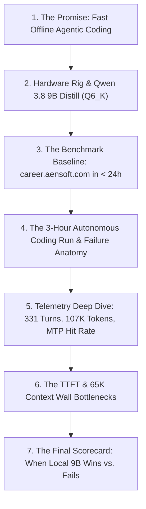
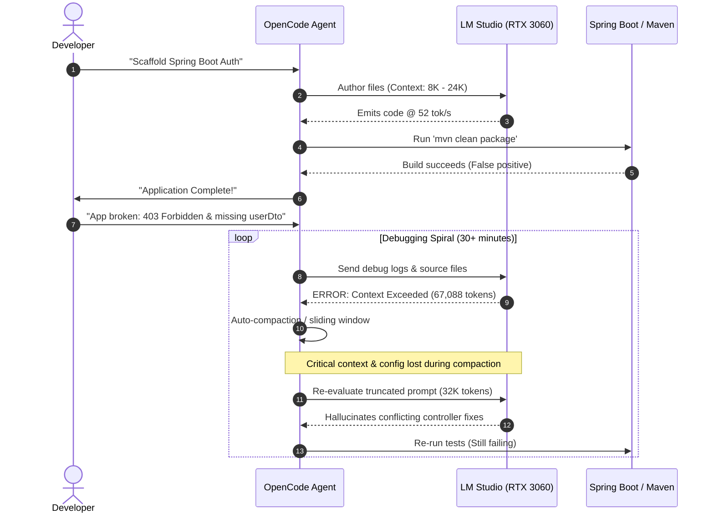

## 💡 The Autonomous Engineering Dream vs. Hardware Reality

Can a \$280 budget consumer GPU—the **NVIDIA GeForce RTX 3060 12GB**—power an autonomous junior software engineer capable of scaffolding, building, and debugging a production-grade full-stack enterprise application completely offline?

The promise of local open-weights AI is intoxicating:
1. **Zero Recurring API Costs:** No per-token billing, rate limits, or surprise cloud invoices.
2. **Total Codebase Privacy:** Proprietary business logic, credentials, and schemas never leave your local machine.
3. **Blazing Local Inference:** Hardware-accelerated matrix multiplication running over local PCIe and GDDR6 VRAM without internet latency.

With the recent wave of hybrid linear-attention architectures, distillation techniques, and built-in **Multi-Token Prediction (MTP) Speculative Decoding**, sub-10B parameter models now routinely advertise decode speeds in excess of **50 to 80 tokens per second** on consumer hardware.



To test whether raw local generation speed translates into autonomous engineering capability, we put `empero-ai/Qwen3.8-9B-Distill` through a real-world software engineering gauntlet inside **VS Code** via the **OpenCode** agent harness, backed by an **LM Studio** local inference server.

The result was a fascinating tale of two extremes: **an A+ in silicon efficiency and hardware throughput**, but an **F in autonomous full-stack software delivery**.

---

## 🖥️ The Test Rig & Model Under Test

All tests were performed on a dedicated consumer workstation with real-time hardware telemetry monitored on-screen via Windows Task Manager and LM Studio server debug logging.

| Component | Specification | Operational Role |
| :--- | :--- | :--- |
| **GPU** | NVIDIA GeForce RTX 3060 12GB GDDR6 (192-bit bus, 360 GB/s bandwidth) | Primary inference compute & KV cache hosting |
| **CPU** | AMD Ryzen 5 5600 (6 Cores, 12 Threads, up to 4.4 GHz) | Maven compilation, background server processes, OS tasks |
| **System RAM** | 32 GB DDR4 @ 3200 MHz (Dual-Channel) | Host OS, JVM, build cache, and OpenCode workspace |
| **Local LLM Server** | LM Studio v0.3.x (`llama.cpp` CUDA backend) | OpenAI-compatible local server with MTP decoding enabled |
| **Agent Harness** | OpenCode CLI inside VS Code Integrated Terminal | Autonomous multi-step file creation, shell commands, test runs |
| **Power Consumption** | ~350W average system draw under active GPU + CPU load | Measured at the wall during active compilation and generation |


_Figure 1: Architectural pillars of the empero-ai/Qwen3.8-9B-Distill model and the RTX 3060 12GB testing environment._

### ⚠️ Essential Community Model Disclaimer

> [!WARNING]
> **Lineage Clarification:** There is currently **no official Alibaba release named Qwen 3.8 9B**.  
> The model under evaluation is `empero-ai/Qwen3.8-9B-Distill`, an open-weights community distillation created by fine-tuning on top of the **Qwen 3.5 9B** hybrid architecture (which features a 3:1 ratio of Linear-Attention Gated DeltaNet layers to Full Attention layers).

We selected the **`Q6_K` quantization** (7.56 GB file size). On a 12GB VRAM card, `Q6_K` represents the ideal "near-lossless" sweet spot: it fits 100% of the model weights onto the GPU while leaving roughly **4.4 GB of physical VRAM** for CUDA scratch buffers and the FP16 KV cache.

When loaded into LM Studio with the maximum **65,536 token context window**, dedicated VRAM locked in at **10.0 / 12.0 GB** with **zero shared memory spillover** into system RAM.

---

## 🎯 The Baseline: Building career.aensoft.com in < 24 Hours

To establish a fair and realistic benchmark, we must define what modern autonomous AI engineering looks like when it succeeds.

Recently, I designed, developed, and deployed [career.aensoft.com](https://career.aensoft.com)—a production job board platform—in **under 24 hours** using **Google Antigravity**.


_Figure 2: Architecture, enterprise tech stack, and the hybrid Claude + Gemini workflow that built career.aensoft.com in under 24 hours._

### The Enterprise Stack
The application was built on modern enterprise Java standards:
- **Backend:** Spring Boot 4.1.1
- **UI & Templating:** Thymeleaf integrated with the CoreUI Admin Template (Bootstrap 5)
- **Persistence & Security:** Spring Data JPA, Spring Security with `JdbcAuthentication`, and BCrypt password hashing
- **Database:** PostgreSQL with relational integrity, composite indexes, and foreign keys

### The Hybrid Frontier AI Methodology
The secret to building a complete production application in less than a day was a strict **two-stage hybrid cloud tiering model**:

1. **Architectural Planning (Frontier Reasoning):**  
   We used **Claude Sonnet** and **Gemini Pro** for upfront architectural research: designing relational schema definitions (DDL, constraints, indexing strategies), selecting security filter chains, and mapping out controller-to-view route contracts.
2. **Implementation & Vibe Coding (High-Speed Execution):**  
   Once the architecture and interface contracts were locked down, the execution plan was handed to **Gemini Flash**. Across 5 to 10 iterative prompts, Gemini Flash generated the Spring Data repositories, security configurations, controllers, and CoreUI Thymeleaf templates.

The total development cycle took less than a single calendar day, resulting in clean, working, and deployable code on the first attempt.

---

## 🥊 The Local Benchmark Challenge: Scaffold Spring Boot Auth

For our local test of Qwen 3.8 9B Distill, we did **not** ask it to build the entire job board platform. Instead, we gave it a **much smaller, isolated slice of the exact same stack**:

> **Task Prompt for OpenCode:**  
> *"Scaffold a working Spring Boot 4.1.1 web application with Spring Security, Thymeleaf, and CoreUI Bootstrap 5. Implement a functional User Registration page and Login page with proper form validation, BCrypt password hashing, and clean UI styling matching the CoreUI admin layout."*

### Phase 1: The 2-Hour "False Completion"
OpenCode initialized the project directory, generated the Maven `pom.xml`, and began authoring Java source files.

Watching the agent execute was mesmerizing at first:
- The RTX 3060 was pinned at **95% to 98% GPU utilization** with fan temperatures holding steady at 74°C to 78°C.
- Code generated on screen at a rapid pace—scaffolding entity classes, repository interfaces, and security configurations.
- Two hours into the session, Qwen compiled the project using `mvn clean package`, ran a series of `curl` checks against localhost, and **declared the task complete**.

### Phase 2: The Reality Check
When we launched the compiled Spring Boot application and navigated to `http://localhost:8080/login` in the browser, the illusion collapsed:
1. **Broken Authentication Pipeline:** Submitting credentials resulted in unhandled Spring Security redirects and 403 Forbidden exceptions.
2. **Missing Registration Flow:** The registration endpoint threw runtime Thymeleaf parsing errors because model attributes expected by the template were never bound in the controller.
3. **Mangled UI:** The CoreUI CSS and JavaScript assets were misrouted in the resource handler, leaving raw, unstyled HTML input fields.

Despite generating thousands of lines of syntactically valid Java, the model failed to understand how the security filter chain, controller models, and view templates fit together.

### Phase 3: The 30+ Minute Debugging Death Spiral
We initiated follow-up "vibe coding" prompts inside OpenCode to guide Qwen through the stack traces:
- *"Fix the login redirect loop in SecurityConfig.java."*
- *"The registration view is failing with a TemplateInputException: model attribute 'userDto' is missing."*

Instead of fixing the bugs, Qwen entered a destructive circular loop:
- It repeatedly rewrote `SecurityConfig.java`, breaking working session management.
- It created duplicate controller routes that conflicted with Spring MVC mappings.
- The conversation context inside OpenCode exploded past **600 messages**.

After **3 hours of continuous execution**, the application was still completely broken. We terminated the run.

### ⚡ Energy Cost Audit
What did this failed 3-hour experiment cost in real resources?

$$\text{Energy Consumed} = \frac{350\text{ W} \times 3\text{ hours}}{1000} = 1.05\text{ kWh}$$

$$\text{Total Electricity Cost} = 1.05\text{ kWh} \times \$0.25/\text{kWh} = \$0.2625\text{ (26.25 cents)}$$

While spending **26.25 cents** for 3 hours of full-bore GPU computation is dirt cheap compared to enterprise GPU rental clusters, it yielded **zero lines of working software**.

---

## 📊 Telemetry Deep Dive (Parsed from 202MB Server Logs)

To understand exactly what happened under the hood, we parsed the entire **202-megabyte LM Studio server log** (`lm_studio_server.log`), containing **3,425,005 lines of debug output** across **331 prompt evaluations** and **107,313 generated tokens**.

Here is what the real data reveals.

---

### 1. Token Generation Speed & MTP Speculative Decoding


_Figure 3: Token generation throughput distribution across context depths and MTP draft acceptance telemetry._

Across all 331 generation turns, Qwen 3.8 9B Distill posted extraordinary throughput numbers for an RTX 3060:

| Metric | Measured Value | Significance |
| :--- | :---: | :--- |
| **Average Generation Speed** | **52.36 tok/s** | Extremely fast for a 9B model at Q6_K quantization |
| **Peak Generation Speed** | **66.05 tok/s** | Achieved during short code snippet drafts (15.14 ms/tok) |
| **Minimum Generation Speed** | **23.69 tok/s** | Occurred under heavy 65K KV-cache saturation |
| **Total Draft Tokens** | **65,580** | Generated by native Multi-Token Prediction heads |
| **Accepted Draft Tokens** | **62,840** | Successfully verified by main model |
| **MTP Draft Acceptance Rate** | **95.82%** | Outstanding predictive efficiency |
| **Mean Burst Length** | **2.72 tokens** | Tokens verified per forward pass |

#### Throughput Scaling by Context Depth
As the agentic session accumulated conversation history, the sheer weight of computing attention over the expanding KV cache degraded generation speed:

```
0 – 8K Context:    ████████████████████████████████ 63.8 tok/s (Peak: 66.05)
8K – 16K Context:  ████████████████████████████ 57.4 tok/s
16K – 32K Context: ████████████████████████ 52.1 tok/s (Session Mean)
32K – 48K Context: ████████████████████ 44.6 tok/s
48K – 65K Context: ███████████████ 31.2 tok/s (Min: 23.69)
```

Even at the full 65,536 context boundary, decode throughput stayed above **31 tok/s**, confirming that memory bandwidth on the RTX 3060 (192-bit GDDR6) handles Q6_K inference effortlessly.

---

### 2. Prompt Processing & The Time-to-First-Token (TTFT) Bottleneck

While decode throughput (tok/s) gets all the marketing attention, in an agentic coding workflow, **prompt prefill speed and Time to First Token (TTFT) dictate the true developer experience**.


_Figure 4: Prompt evaluation throughput and Time to First Token (TTFT) scaling as agent context expands._

Every time an agent executes a tool—such as reading a file, inspecting a directory, or capturing compiler output—the new content invalidates prior KV cache states, forcing the GPU to re-evaluate the entire prompt.

| Metric | Measured Value | Telemetry Detail |
| :--- | :---: | :--- |
| **Average Prompt Processing** | **829.98 tok/s** | Measured across all 331 prompt evaluations |
| **Peak Prompt Prefill** | **1,272.72 tok/s** | Reached during sequential prompt streaming |
| **Max Chunk Burst** | **1,510.00 tok/s** | Peak compute burst on chunked prefill (Task 38101) |
| **Fastest TTFT (Cached)** | **0.11 s (109 ms)** | Instantaneous response on 17-token delta prompts |
| **Average TTFT Latency** | **9.07 seconds** | Session mean wait time per turn |
| **Maximum TTFT Latency** | **22.90 seconds** | Recorded on a 24,486-token prompt re-evaluation |

#### The Hidden 50-Minute Wait
Because autonomous agents submit substantial context payloads on every turn (the average uncached prompt was **11,098 tokens**), the developer must sit and wait for prefill before a single token can be generated:

$$\text{Cumulative Prefill Wait} = 331\text{ turns} \times 9.07\text{ seconds} \approx 3,002\text{ seconds} \approx \mathbf{50.0\text{ minutes}}$$

> [!IMPORTANT]
> Out of the 3-hour coding session, **nearly one full hour (50 minutes) was spent doing nothing but waiting for the GPU to prefill and ingest prompts**.  
> This illustrates why local agentic loops feel sluggish despite impressive 50+ tok/s generation speeds.

---

## 🧱 The 65,536 Context Wall & Architectural Collapse

Why did Qwen 3.8 9B fail to complete a basic Spring Boot application that Gemini Flash built effortlessly?

The server log provides an irrefutable answer: **the model hit the 65,536 context limit 280 times**.


_Figure 5: Telemetry timeline of context overflows in LM Studio and final benchmark scorecard._

```
[LM Studio Server Log Telemetry - Error Distribution]
Total "request exceeds available context size (65536 tokens)" occurrences: 280
Earliest Context Overflow: 15:26:12 (Task 11063 - 65,555 tokens)
Largest Rejected Request:  17:45:56 (Task 47195 - 244,475 tokens)
Total Messages at Crash:   611 conversation turns
```

### The Anatomy of an Agent Crash



1. **Context Saturation (15:26):** Less than 25 minutes into debugging, the prompt payload crossed 65,555 tokens.
2. **Auto-Compaction Amnesia:** OpenCode attempted to recover by compacting earlier conversation history down to 32,160 tokens. However, this wiped out the original architectural plan, controller contracts, and Thymeleaf form bindings.
3. **Runaway Context Bloat:** In its desperate attempt to fix the compile and runtime issues, OpenCode appended full stack traces, directory listings, and file contents. By 17:45, requests were attempting to send **244,475 tokens** into a 65K server window.
4. **Attention Dilution:** 9-billion parameter dense models do not possess the "needle-in-a-haystack" retrieval precision required to correlate a security filter in `SecurityConfig.java` with a form action in `login.html` across 30,000+ tokens of noisy conversation.

---

## 🏆 The Comprehensive Scorecard

Evaluating the entire experiment across hardware efficiency, raw speed, and software engineering capability yields the following verdict:

| Evaluation Dimension | Benchmark Metric | Grade | Rationale |
| :--- | :--- | :---: | :--- |
| **12GB VRAM Fit & Thermals** | 10.0 / 12.0 GB VRAM • 78°C Max | **A+** | Near-lossless Q6_K quantization fits 100% on GPU with 65K context. Zero PCIe spillover. |
| **Token Generation Speed** | 52.36 tok/s Avg • 66.05 tok/s Peak | **A+** | Outstanding MTP speculative decoding hit rate (95.82%) delivers near-frontier speed. |
| **Prompt Prefill Throughput** | 829.98 tok/s Avg • 1,510 tok/s Burst | **A** | Fast chunked prompt evaluation on RTX 3060 CUDA cores. |
| **Multi-Turn Agent Latency** | 9.07s Avg TTFT • 22.90s Max TTFT | **C** | Cumulative 50 minutes spent waiting on uncached 11K-token prompt evaluations. |
| **Full-Stack Autonomous Coding** | 3 Hours • 280 Errors • Broken App | **F** | Unable to scaffold working Spring Security + Thymeleaf app. Context explosion. |

---

## 💡 Practical Recommendations: When to Use Local vs. Cloud

This benchmark makes the dividing line between local sub-10B models and frontier cloud agents abundantly clear.

### ✅ What Local 9B Models Are Great For:
1. **Interactive Inline Autocomplete:** Instantaneous tab-completion inside IDEs without cloud latency.
2. **Single-File Functions & Utility Scripts:** Writing pure algorithms, regex patterns, Bash/Python utility scripts, and unit test fixtures.
3. **Private Code Explanation & Refactoring:** Pasting a single sensitive class or SQL query for explanation or localized optimization.
4. **Offline Terminal Assistance:** Command-line syntax translation (`ffmpeg`, `git`, `docker`, `awk`).

### ❌ What Requires Frontier Cloud Agents (Google Antigravity / Claude / Gemini):
1. **Multi-File Architecture & Scaffolding:** Maintaining strict dependency alignment across configurations, repositories, services, controllers, and UI templates.
2. **Complex Frameworks (Spring Security, Next.js, Kubernetes):** Frameworks where runtime behavior depends on intricate lifecycle hooks and filter chains.
3. **Iterative Autonomous Debugging:** Agents that can ingest massive build logs and stack traces without overflowing context or losing the architectural thread.
4. **Production Timelines:** When software needs to be delivered and deployed in hours, not lost in a 3-hour local debugging death spiral.

---

## 🏁 Conclusion

The **empero-ai/Qwen3.8-9B-Distill** running on an **RTX 3060 12GB** is an engineering marvel in terms of hardware optimization. Generating **52+ tokens per second** locally at near-FP16 precision with a **95.8% MTP draft acceptance rate** proves that consumer GPUs can easily host blazing-fast local inference.

However, **throughput is not intelligence**. 

For autonomous software engineering, a model must maintain a coherent mental model of a complex repository across dozens of interrelated files. Until local models reach the reasoning depth and context management of frontier systems like Claude Sonnet and Gemini Pro, the winning formula remains **hybrid**: leverage local models for zero-cost, low-latency micro-tasks, and deploy frontier cloud agents like **Google Antigravity** when you actually need to ship production software.

---

*Tested with OpenCode in VS Code, LM Studio v0.3.x, and telemetry parsed from `lm_studio_server.log`.*
