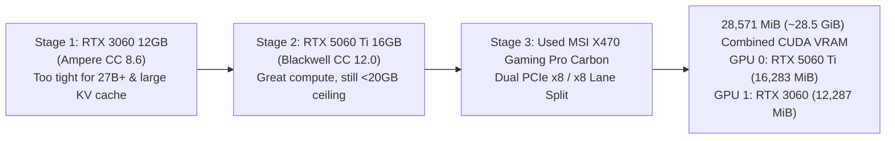
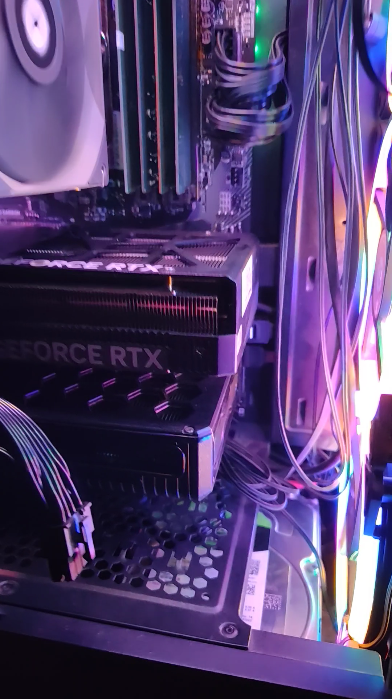
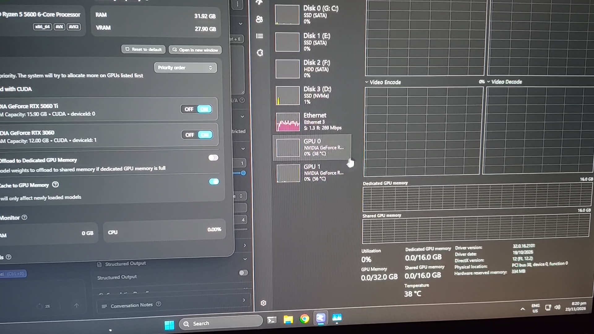
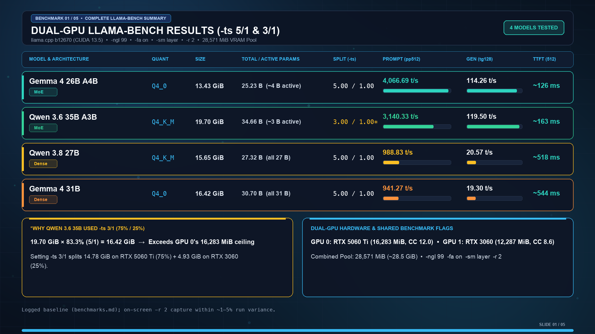
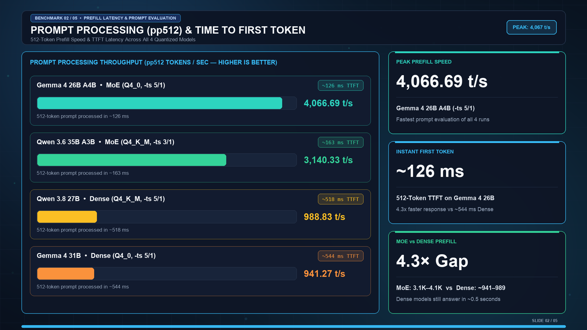
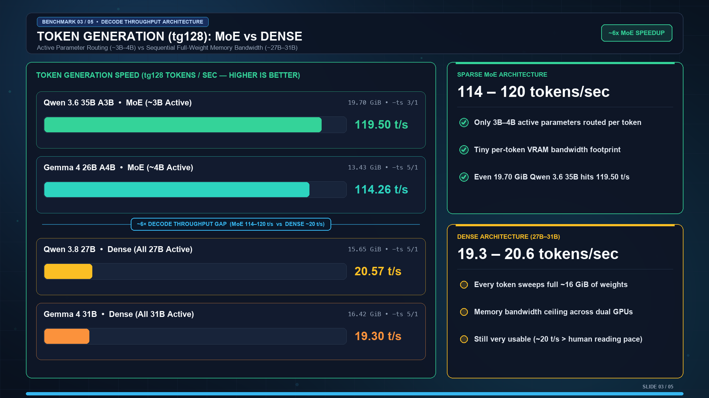
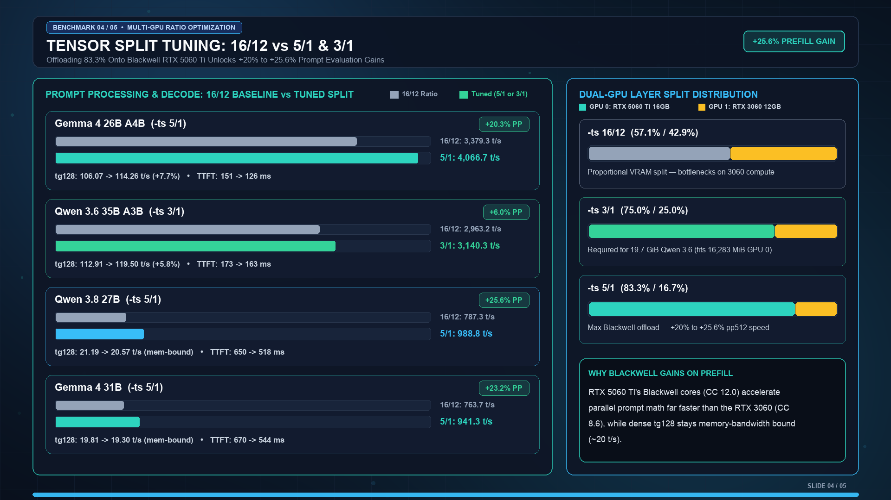
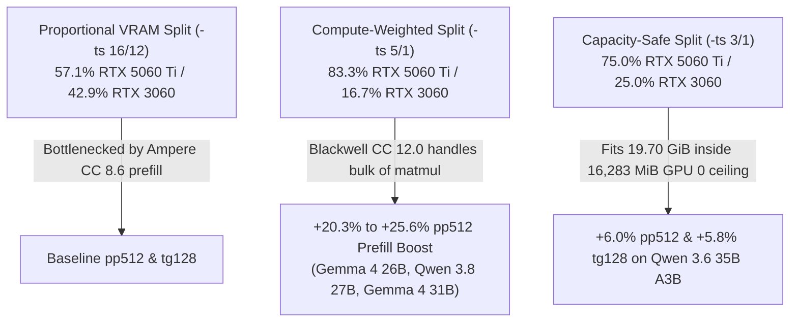
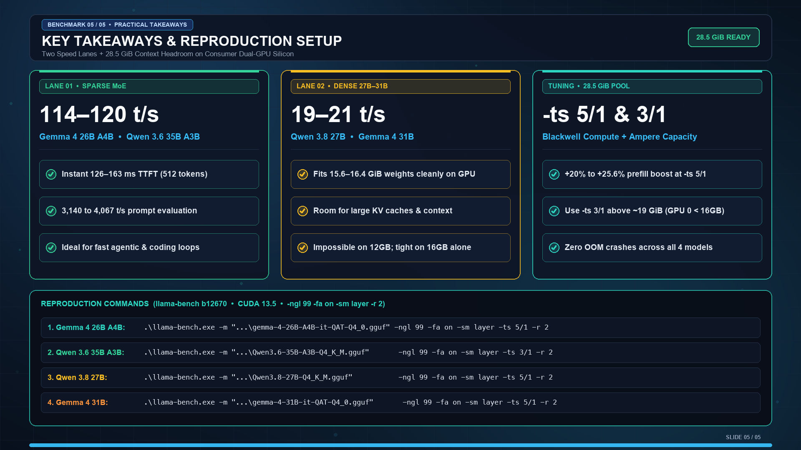

[](https://github.com/allensandiego){:target="_blank" rel="noopener noreferrer"}
[](https://www.youtube.com/@aenlesan){:target="_blank" rel="noopener noreferrer"}

---

## 💡 The Upgrade Journey: From 12GB to 16GB to 28.5 GiB Dual-GPU

Running genuinely capable local LLMs on consumer hardware is fundamentally a VRAM capacity problem.

For years, my local workstation ran a single **NVIDIA GeForce RTX 3060 12GB**. While it was a reliable entry point for small quantized models, I could never make models that fit inside a 12GB ceiling—especially after reserving room for long context windows and KV caches—truly useful for my real-world coding and agentic workflows (as documented in my [Qwen 3.8 9B Distill RTX 3060 benchmark]({{ '/posts/benchmarking-qwen38-9b-distill-rtx-3060-agentic-coding/' | relative_url }})).

Later, I picked up an **RTX 5060 Ti 16GB** during a steep sale discount. Stepping up to 16GB of GDDR7 Blackwell silicon unlocked higher quantizations like `Q6_K` and faster speculative decoding, which helped on several isolated tasks ([Qwen 3.5 9B MTP RTX 5060 Ti benchmark]({{ '/posts/benchmarking-qwen35-9b-mtp-q6k-rtx-5060ti-faking-tests/' | relative_url }})), yet 16GB still fell just shy of comfortably hosting 27B–35B class models with generous context headroom.

Instead of shelling out for a flagship 24GB or 32GB workstation card, I hunted down a used **MSI X470 Gaming Pro Carbon** motherboard specifically for its **dual PCIe x8/x8 lane bifurcation**. Dropping both GPUs onto one board instantly merged Blackwell and Ampere silicon into **28,571 MiB (~28.5 GiB) of combined CUDA VRAM**.




_Figure 1: Both cards seated in the MSI X470 Gaming Pro Carbon running in dual PCIe x8/x8 configuration._


_Figure 2: CUDA exposing both devices (GPU 0 RTX 5060 Ti 16GB + GPU 1 RTX 3060 12GB) as a unified ~28.5 GiB pool._

---

## 🖥️ Hardware & Test Environment

All runs were executed using **`llama-bench`** from **`llama.cpp` (`b12670-239242322`)** compiled with **CUDA 13.5**, keeping all model layers on GPU (`-ngl 99`), Flash Attention enabled (`-fa on`), layer-level multi-GPU splitting (`-sm layer`), and 2 repetitions (`-r 2`) per test.

| Component / Flag | Specification | Role in Benchmark |
| :--- | :--- | :--- |
| **CPU** | AMD Ryzen 5 5600 (6C / 12T) | Host orchestration & PCIe lane feeding |
| **Motherboard** | MSI X470 Gaming Pro Carbon | Dual PCIe x8 / x8 lane split across primary slots |
| **System RAM** | 32 GB DDR4 | Host memory (zero CPU weight offload during tests) |
| **GPU 0 (Primary)** | NVIDIA GeForce RTX 5060 Ti (Blackwell, CC 12.0) | 16,283 MiB VRAM — carries 75% to 83.3% of layers |
| **GPU 1 (Secondary)** | NVIDIA GeForce RTX 3060 (Ampere, CC 8.6) | 12,287 MiB VRAM — provides overflow capacity |
| **Combined CUDA Pool** | **28,571 MiB (~28.5 GiB)** | Hosts 13.43 GiB – 19.70 GiB models cleanly in VRAM |
| **Inference Engine** | `llama.cpp` `b12670-239242322` (CUDA 13.5) | `-ngl 99 -fa on -sm layer -r 2` |

---

## 📊 Complete Benchmark Results (`-ts 5/1` & `3/1`)

For the inaugural benchmark suite on this rig, I tested four open-weights models spanning both **Sparse Mixture-of-Experts (MoE)** and **Dense** architectures across the **Gemma 4** and **Qwen 3.6 / 3.8** families.


_Figure 3: Complete side-by-side `llama-bench` summary across all four quantized models on the 28.5 GiB dual-GPU pool._

| Model Architecture | Quantization | Size (GiB) | Total / Active Params | Tensor Split (`-ts`) | Prompt Processing (`pp512`) | Generation (`tg128`) | TTFT (512 tokens) |
| :--- | :---: | :---: | :---: | :---: | :---: | :---: | :---: |
| **Gemma 4 26B A4B** *(MoE)* | `Q4_0` | 13.43 GiB | 25.23 B (~4 B active) | `5.00/1.00` | **4,066.69 ± 150.22 t/s** | **114.26 ± 0.18 t/s** | **~126 ms** |
| **Qwen 3.6 35B A3B** *(MoE)* | `Q4_K_M` | 19.70 GiB | 34.66 B (~3 B active) | `3.00/1.00`* | **3,140.33 ± 0.00 t/s** | **119.50 ± 0.00 t/s** | **~163 ms** |
| **Qwen 3.8 27B** *(Dense)* | `Q4_K_M` | 15.65 GiB | 27.32 B (all 27 B active) | `5.00/1.00` | **988.83 ± 8.13 t/s** | **20.57 ± 1.07 t/s** | **~518 ms** |
| **Gemma 4 31B** *(Dense)* | `Q4_0` | 16.42 GiB | 30.70 B (all 31 B active) | `5.00/1.00` | **941.27 ± 8.08 t/s** | **19.30 ± 0.87 t/s** | **~544 ms** |

*\*Why Qwen 3.6 35B A3B ran at `-ts 3/1`:* At `19.70 GiB`, an aggressive `5/1` split (83.3% / 16.7%) attempts to place **16.42 GiB** onto GPU 0, exceeding the RTX 5060 Ti's **16,283 MiB** capacity. Dialing back to **`-ts 3/1`** (75% / 25%) allocates ~14.78 GiB to the RTX 5060 Ti and ~4.93 GiB to the RTX 3060, fitting cleanly without OOM.

---

## ⚡ Prompt Processing (`pp512`) & Time to First Token

When you feed large codebases, tool outputs, or multi-turn agent histories into a local model, **prompt processing (`pp512`)** dictates how long you wait before the first token streams back.


_Figure 4: 512-token prompt evaluation throughput and Time-to-First-Token (TTFT) across MoE and dense architectures._

- **Gemma 4 26B A4B (MoE)** takes the crown at **4,066.69 t/s**, evaluating a 512-token prompt in **~126 ms**—effectively instantaneous in interactive chat and coding loops.
- **Qwen 3.6 35B A3B (MoE)** follows closely at **3,140.33 t/s** (**~163 ms** TTFT) despite carrying nearly 20 GiB of total weights across both GPUs.
- **Qwen 3.8 27B** (**988.83 t/s**, **~518 ms**) and **Gemma 4 31B** (**941.27 t/s**, **~544 ms**) show the expected ~4.3× compute gap against sparse MoE prefill, yet still deliver sub-second TTFT for 512-token prompts.

---

## 🚀 Token Generation (`tg128`): The ~6× MoE vs. Dense Split

On token decode (`tg128`), the architectural difference between sparse routing and dense full-weight sweeps dominates the chart.


_Figure 5: Token generation throughput showing ~114–120 t/s for sparse MoE models versus ~19.3–20.6 t/s for dense 27B–31B models._

1. **Sparse MoE Lane (114.26 – 119.50 t/s):**  
   Both **Qwen 3.6 35B A3B** (**119.50 t/s**) and **Gemma 4 26B A4B** (**114.26 t/s**) only activate roughly **3B to 4B parameters per token**. Because each decode step reads a tiny fraction of total VRAM weights, throughput scales past **100+ tokens/sec** even when split across dual PCIe x8 slots.
2. **Dense Heavyweight Lane (19.30 – 20.57 t/s):**  
   **Qwen 3.8 27B** (**20.57 t/s**) and **Gemma 4 31B** (**19.30 t/s**) must sequentially stream their entire **~15.65–16.42 GiB** weight footprint through memory bandwidth on every single generated token. Around **~20 t/s** is still comfortably faster than human reading pace—and previously impossible to run fully in VRAM on a 12GB or 16GB card with usable KV cache headroom.

---

## 🎛️ Tensor Split Tuning: Why `-ts 5/1` Beats Proportional `16/12`

A naive multi-GPU setup splits layers proportionally by VRAM size—for 16GB + 12GB, that's `-ts 16/12` (57.1% / 42.9%). However, pairing a **Blackwell RTX 5060 Ti (CC 12.0)** with an older **Ampere RTX 3060 (CC 8.6)** creates an asymmetric compute profile: pushing 43% of the workload onto the RTX 3060 bottlenecks prefill.


_Figure 6: Comparing proportional `-ts 16/12` against Blackwell-biased `-ts 5/1` and `-ts 3/1` splits._



| Model | Ratio (`-ts`) | Prompt Processing (`pp512`) | Generation (`tg128`) | TTFT (512 tokens) |
| :--- | :---: | :---: | :---: | :---: |
| **Gemma 4 26B A4B** *(MoE)* | `16/12`<br>**`5/1`** | 3,379.32 t/s<br>**4,066.69 t/s** *(+20.3%)* | 106.07 t/s<br>**114.26 t/s** *(+7.7%)* | 151 ms<br>**126 ms** |
| **Qwen 3.6 35B A3B** *(MoE)* | `16/12`<br>**`3/1`** | 2,963.17 t/s<br>**3,140.33 t/s** *(+6.0%)* | 112.91 t/s<br>**119.50 t/s** *(+5.8%)* | 173 ms<br>**163 ms** |
| **Qwen 3.8 27B** *(Dense)* | `16/12`<br>**`5/1`** | 787.30 t/s<br>**988.83 t/s** *(+25.6%)* | 21.19 t/s<br>**20.57 t/s** | 650 ms<br>**518 ms** |
| **Gemma 4 31B** *(Dense)* | `16/12`<br>**`5/1`** | 763.73 t/s<br>**941.27 t/s** *(+23.2%)* | 19.81 t/s<br>**19.30 t/s** | 670 ms<br>**544 ms** |

Shifting **83.3%** of layers onto the RTX 5060 Ti delivered a free **+20.3% to +25.6% prompt processing boost** across the board (`-ts 5/1`), while even the memory-capped `-ts 3/1` run on Qwen 3.6 35B A3B gained **+6.0%** on prefill and **+5.8%** on generation. Meanwhile, dense generation stayed essentially flat (~20 t/s) because decode on dense weights remains bound by VRAM memory bandwidth rather than compute cores.

---

## 🛠️ Reproducing the Benchmark & Raw Output

You can reproduce these exact runs with `llama-bench` using the flags below (adjust `<MODELS_DIR>` to your local GGUF directory):

```powershell
# 1. Gemma 4 26B A4B (MoE)
.\llama-bench.exe -m "<MODELS_DIR>\gemma-4-26B-A4B-it-QAT-GGUF\gemma-4-26B-A4B-it-QAT-Q4_0.gguf" -ngl 99 -fa on -sm layer -ts 5/1 -r 2

# 2. Qwen 3.6 35B A3B (MoE)
.\llama-bench.exe -m "<MODELS_DIR>\Qwen3.6-35B-A3B-GGUF\Qwen3.6-35B-A3B-Q4_K_M.gguf" -ngl 99 -fa on -sm layer -ts 3/1 -r 2

# 3. Qwen 3.8 27B (Dense)
.\llama-bench.exe -m "<MODELS_DIR>\Qwen3.8-27B-GGUF\Qwen3.8-27B-Q4_K_M.gguf" -ngl 99 -fa on -sm layer -ts 5/1 -r 2

# 4. Gemma 4 31B (Dense)
.\llama-bench.exe -m "<MODELS_DIR>\gemma-4-31B-it-QAT-GGUF\gemma-4-31B-it-QAT-Q4_0.gguf" -ngl 99 -fa on -sm layer -ts 5/1 -r 2
```

### Raw `llama-bench` Output

```text
| model                           |       size |     params | backend    | ngl |  fa | ts           |            test |                  t/s |
| ------------------------------- | ---------: | ---------: | ---------- | --: | --: | ------------ | --------------: | -------------------: |
| gemma4 26B.A4B Q4_0             |  13.43 GiB |    25.23 B | CUDA       |  99 |   1 | 5.00/1.00    |           pp512 |     4066.69 ± 150.22 |
| gemma4 26B.A4B Q4_0             |  13.43 GiB |    25.23 B | CUDA       |  99 |   1 | 5.00/1.00    |           tg128 |        114.26 ± 0.18 |
| qwen35moe 35B.A3B Q4_K - Medium |  19.70 GiB |    34.66 B | CUDA       |  99 |   1 | 3.00/1.00    |           pp512 |       3140.33 ± 0.00 |
| qwen35moe 35B.A3B Q4_K - Medium |  19.70 GiB |    34.66 B | CUDA       |  99 |   1 | 3.00/1.00    |           tg128 |        119.50 ± 0.00 |
| qwen35 27B Q4_K - Medium        |  15.65 GiB |    27.32 B | CUDA       |  99 |   1 | 5.00/1.00    |           pp512 |        988.83 ± 8.13 |
| qwen35 27B Q4_K - Medium        |  15.65 GiB |    27.32 B | CUDA       |  99 |   1 | 5.00/1.00    |           tg128 |         20.57 ± 1.07 |
| gemma4 31B Q4_0                 |  16.42 GiB |    30.70 B | CUDA       |  99 |   1 | 5.00/1.00    |           pp512 |        941.27 ± 8.08 |
| gemma4 31B Q4_0                 |  16.42 GiB |    30.70 B | CUDA       |  99 |   1 | 5.00/1.00    |           tg128 |         19.30 ± 0.87 |
```

---

## 🎯 Key Takeaways & What's Next


_Figure 7: Summary of the two performance lanes unlocked by the 28.5 GiB dual-GPU setup._

Pairing a discounted **RTX 5060 Ti 16GB** with an existing **RTX 3060 12GB** on a used **MSI X470** board completely changed what this workstation can execute locally:

1. **Two Practical Inference Lanes:** **114–120 t/s** on sparse MoE models (`Gemma 4 26B A4B` & `Qwen 3.6 35B A3B`) for rapid agentic/coding loops, and **19–21 t/s** on 27B–31B dense heavyweights (`Qwen 3.8 27B` & `Gemma 4 31B`).
2. **Real Context & KV Cache Headroom:** With **28.5 GiB** of CUDA VRAM, 13–19 GiB models leave genuine room for long context windows instead of scraping the 12GB/16GB ceiling.
3. **Always Bias `-ts` Toward Faster Silicon:** Treating dual heterogeneous GPUs equally (`16/12`) leaves **20–25%+** prompt evaluation speed on the table; biasing layers toward the Blackwell card (`5/1`, or `3/1` when model size demands it) is a free performance win.

I am just getting started benchmarking this 28.5 GiB rig. Next up, I will be testing additional models, higher quantizations, and real-world agentic coding tasks to see which model actually holds up in practice. Follow along on YouTube and GitHub to catch the next results as soon as they drop!

[](https://github.com/allensandiego){:target="_blank" rel="noopener noreferrer"}
[](https://www.youtube.com/@aenlesan){:target="_blank" rel="noopener noreferrer"}
